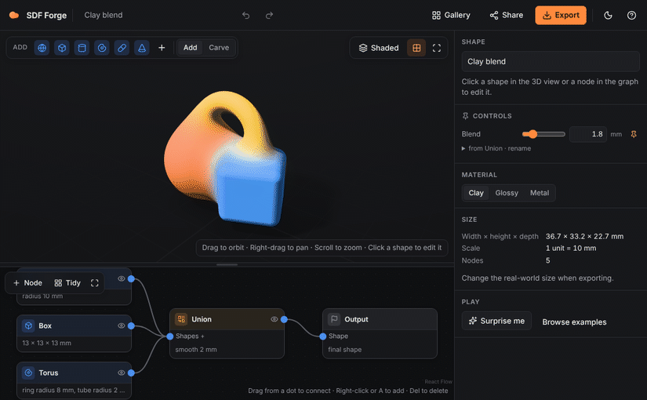
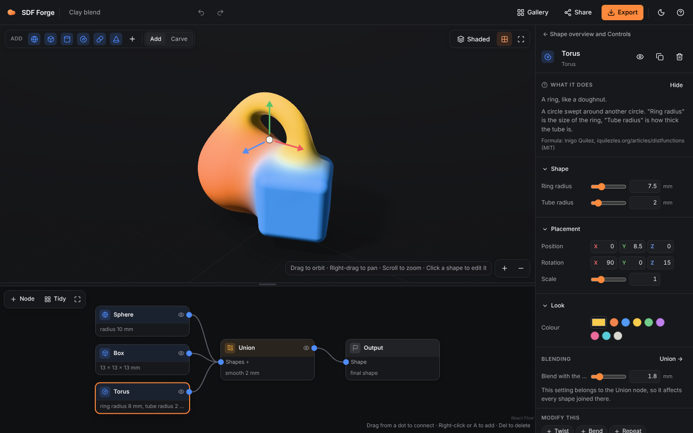
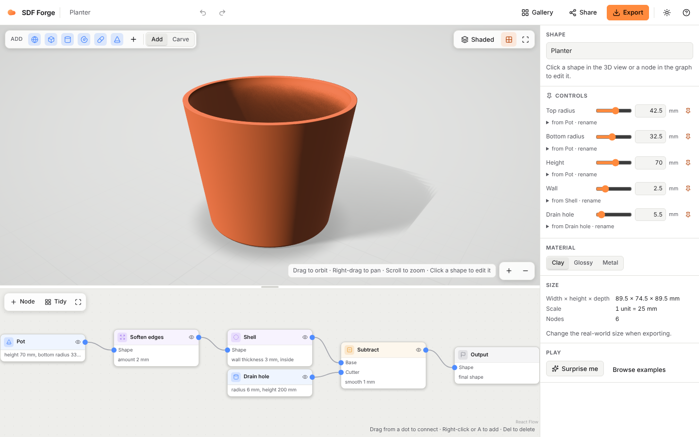
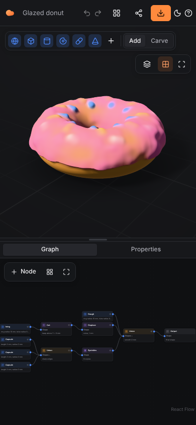

# SDF Forge

**Build 3D shapes in your browser by connecting nodes — then print them, put them in a game, or take the shader code.**

**▶ Live site: <https://vincentwesley.github.io/sdf-forge/>**



SDF Forge is a small, fast "mini Houdini" for **signed distance functions** (SDFs). Every shape is a recipe of
nodes — primitives like spheres, boxes and tori, combined and reshaped with smooth blends, twists, bends,
repetition, mirroring, carving, shells and lattices. The recipe compiles to a shader that ray-marches the result in
real time with soft shadows, and to a CPU evaluator that turns it into a **watertight, manifold mesh**.

Made by **Vin** · **Vin's Atelier**.

| Desktop (dark) | Desktop (light) | Phone |
| --- | --- | --- |
|  |  |  |

## What you can do

- **Start in seconds.** The page opens on a shape you can spin, click and drag. Add shapes from the toolbar (or
  switch to *Carve* to cut holes), move them with the arrows, and blend them like clay. A one-minute tour and a
  plain-language explanation of every node are built in.
- **Go deep when you want to.** 35 node types in a real graph editor: drag a wire into empty space to get a list of
  compatible nodes, right-click to add, view any node on its own, copy/paste between tabs, a command palette
  (`Ctrl/⌘ K`), undo/redo, and number fields that accept arithmetic.
- **Make real things.**
  - **STL** for 3D printing — Z-up millimetres, sized with a "longest side" field, with volume and filament estimates.
    A *Print check* view paints walls thinner than your nozzle red and steep overhangs orange.
  - **3MF** for modern slicers (Bambu Studio, PrusaSlicer, Cura) — millimetres, a colour palette taken from your
    shapes, credit metadata and a preview image, in a file about a fifth the size of the STL.
  - **GLB** (glTF 2.0) with normals and vertex colours, and **OBJ**, for Blender, game engines and the web.
  - **PNG** renders up to 4K (transparent background optional) and **turntable videos** (MP4 or WebM).
  - **Shader code** — a complete Shadertoy shader or just the GLSL distance function (not yet for shapes with text).
- **Draw your own outlines.** The Profile node is a point editor: drag points, add them with a click, and make each
  one a sharp corner or a smooth curve. Spin it with Revolve for vases, bottles and chess pieces, or extrude it for
  brackets and plates. Works with mouse, touch and keyboard.
- **Write on things.** A Text node turns any word into a profile: extrude it into a sign or name tag, or subtract
  it to engrave.
- **Customise templates.** Pin any setting to the *Controls* panel. Printable templates (vase, planter, keychain,
  ring, bowl, gyroid sphere) come with their key sizes pinned, so you can make one your own without touching the graph.
- **Animate.** Any pinned number can swing between two values: press Play in the 3D view, or record it in a
  turntable video (with or without the camera turning). Try the *Sphere to cube* example.
- **Share.** A link holds the whole graph — no account, no server, nothing uploaded.

## How it works

```
graph ─► typed expression IR ─┬─► GLSL  ─► WebGL2 ray marcher (uniforms: sliders never recompile)
                               └─► JS    ─► picking · Manifold level-set meshing · tests
```

- **One definition, two back ends.** Each node's formula is written once in a tiny typed IR (`src/core/ir`); the
  compiler hash-conses it and emits both GLSL and allocation-free scalar JavaScript. Tests check that the GPU and CPU
  agree on every node and example (typically to 10⁻⁷, always within 10⁻³).
- **Correct by construction where it matters.** Every node declares conservative bounds and a Lipschitz estimate,
  so the ray marcher never overshoots (twists and noise slow down instead of tearing) and the mesher always
  encloses the shape.
- **Meshing** uses [Manifold](https://github.com/elalish/manifold)'s level-set extraction (marching tetrahedra on a
  body-centred cubic grid) in a Web Worker, plus a pass that separates pinch-point vertices so slicers that weld by
  position still see a 2-manifold.
- **Rendering**: sphere tracing clipped to the scene bounds, Inigo Quilez's soft shadows and AO, Khronos PBR
  Neutral tone mapping, dynamic resolution while you interact and progressive anti-aliasing when you stop.
  It stays interactive even on software rendering.

More detail: [docs/PLAN.md](docs/PLAN.md) · [docs/DECISIONS.md](docs/DECISIONS.md) · [docs/RESEARCH.md](docs/RESEARCH.md) · [docs/RESOURCES.md](docs/RESOURCES.md) (free 3D resources that are safe to use).

## Quality checks

Everything in [docs/ACCEPTANCE.md](docs/ACCEPTANCE.md) runs in CI on every push:

- unit tests of the compiler against analytic distances, exactness, bounds and step safety;
- GPU-vs-CPU agreement in headless Chromium (SwiftShader);
- every gallery shape exported as STL, 3MF, GLB and OBJ and checked with [trimesh](https://trimesh.org) (watertight,
  manifold, size, volume) and the [Khronos glTF-Validator](https://github.com/KhronosGroup/glTF-Validator);
- Playwright tests of every main flow, axe-core accessibility checks in both themes, screenshots at phone/tablet/
  desktop sizes, and a frame-rate check with software rendering.

## Run it locally

```bash
npm ci
npm run dev            # http://localhost:5173
npm test               # unit tests
npm run build && npm run e2e   # browser tests (npx playwright install chromium once)
npm run acceptance     # everything, including mesh validation (pip install -r scripts/requirements.txt)
```

Requires Node 20+ and a browser with WebGL 2. See [CONTRIBUTING.md](CONTRIBUTING.md) to add a node.

## Accessibility

The interface works with a keyboard (skip link, focusable gizmo arrows that move shapes by 1 mm, accessible menus
and dialogs, a keyboard alternative to dragging wires), follows your light/dark preference and respects
*reduce motion*. The 3D view itself is visual; every action it offers is also available in the panels.

## Credits

- Distance functions, smooth minimum, soft shadows, normals and domain repetition after
  [Inigo Quilez](https://iquilezles.org/articles/) (MIT). Polar repetition after Mercury's
  [hg_sdf](https://mercury.sexy/hg_sdf/) (MIT).
- [Manifold](https://github.com/elalish/manifold) (Apache-2.0) for meshing ·
  [Khronos PBR Neutral](https://github.com/KhronosGroup/ToneMapping) (Apache-2.0) tone mapping.
- Studio reflections: [Studio Small 09](https://polyhaven.com/a/studio_small_09) by Sergej Majboroda,
  [Poly Haven](https://polyhaven.com) (CC0), pre-filtered by `scripts/make_env.py`.
- [React](https://react.dev) (MIT), [React Flow / xyflow](https://reactflow.dev) (MIT), [Zustand](https://github.com/pmndrs/zustand) (MIT),
  [Lucide](https://lucide.dev) icons (ISC), [Inter](https://rsms.me/inter/) typeface (SIL OFL 1.1),
  [Mediabunny](https://mediabunny.dev) (MPL-2.0) for video, [opentype.js](https://opentype.js.org) (MIT) for
  reading glyph outlines.
- Testing: [Playwright](https://playwright.dev), [axe-core](https://github.com/dequelabs/axe-core), [trimesh](https://trimesh.org), [lib3mf](https://github.com/3MFConsortium/lib3mf),
  [glTF-Validator](https://github.com/KhronosGroup/glTF-Validator), [Vitest](https://vitest.dev).

## Licence

[MIT](LICENSE) © 2026 Vin's Atelier. Shapes you make are yours.
